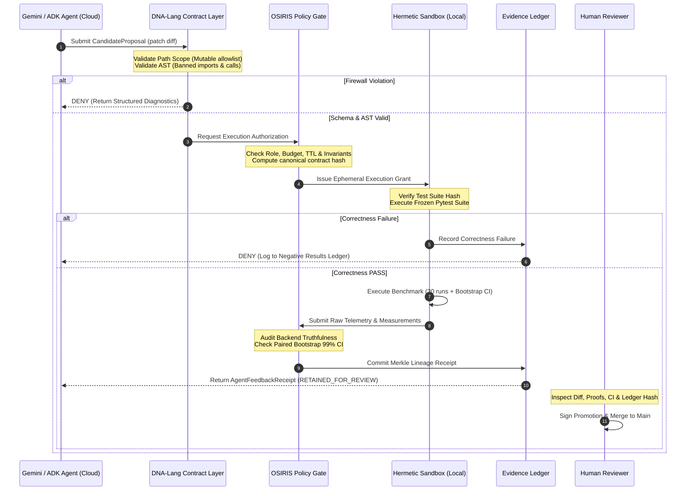

# OSIRIS v4.2.1: A Governed Dual-Substrate Architecture for Local and Cloud Agent Execution
**Author:** Devin Phillip Davis, OSIRIS Architecture Group  
**Category:** Software / Open Research Infrastructure  
**Publication Date:** September 30, 2026 (Enhanced Specification: October 2026)  
**Status:** Architecture Specification & Operational Baseline  

> **Epistemic Scope Note:** This document describes architecture, formal contracts, and empirical evaluation protocols. It does not claim achieved artificial general intelligence, unverified autonomous emergence, or unvalidated physical constants. Where a subsystem has a measured state, that empirical measurement is quoted verbatim. All other mechanisms represent design intent and governing invariants, explicitly labeled as such.

---

## Executive Summary

Enterprise agentic workflows fail when execution authority is either completely centralized in the cloud or implicitly granted to cognitive models. When large language models (LLMs) or autonomous agents are given ambient credentials, shell access, or direct deployment capabilities, failures in reasoning become critical security incidents, corrupted data pipelines, or invalid scientific claims.

**OSIRIS v4.2.1** and **DNA-Lang** establish a durable separation of concerns:

$$\boxed{
\text{Agents propose candidates}
\longrightarrow
\text{DNA-Lang specifies constraints}
\longrightarrow
\text{OSIRIS authorizes bounded evaluation}
\longrightarrow
\text{Evaluators measure}
\longrightarrow
\text{Humans promote}
}$$

- **DNA-Lang** is the *provenance-native contract language*: a typed specification layer defining mutation scope, AST boundaries, frozen evaluator identities, evidence requirements, and promotion criteria.
- **OSIRIS** is the *local-first governance, evidence, and authorization runtime*: an asymmetric authority plane that mediates between cloud orchestration (Google Cloud ADK / GKE) and physical execution substrates (local CPU/GPU, quantum hardware, isolated sandboxes), issuing ephemeral capability grants and enforcing tamper-evident lineage ledgers.

---

## 1. The Dual-Substrate Architecture

### 1.1 The Operational Invariant: "Cognition May Be Distributed; Authority Is Not"

Rather than attempting to move the local runtime wholesale into the cloud or allowing cloud orchestrators unfettered access to edge hardware, OSIRIS divides execution along a strict, asymmetric authority boundary:

```text
                     ┌─────────────────────────────────────────┐
                     │          Google Cloud Platform          │
                     │                                         │
                     │   ADK Agent Orchestrator (GKE / Cloud)  │
                     │   - Multi-agent coordination            │
                     │   - Cognitive models (Gemini 2.5 / ADK) │
                     │   - Scalable GraphRAG context           │
                     └────────────────────┬────────────────────┘
                                          │
                               Governed MCP Boundary
                       (Tool calls treated as proposals only)
                                          │
                                          ▼
┌──────────────────────────────────────────────────────────────────────────────┐
│                            LOCAL OSIRIS RUNTIME                              │
│                                                                              │
│     Policy Gate ──► Ephemeral Grant ──► Sandbox Runner ──► Verifier          │
│          │                 │                   │              │              │
│          ▼                 ▼                   ▼              ▼              │
│      DNA-Lang          Hardware            Hermetic       Evidence           │
│      Contracts         Substrates          Execution       Ledger            │
│   (AST/Path Scope)   (Local/QPU/AVX)       (Isolated)   (Merkle Root)        │
└──────────────────────────────────────────────────────────────────────────────┘
```

The cloud layer (GKE, ADK, Gemini, Cloud Run) provides scalable cognition and workflow coordination. It **never acquires execution rights** over the local machine or downstream production infrastructure. The local OSIRIS runtime acts as the sovereign policy enforcement point: it validates requests against cryptographic contracts, runs sandboxed evaluations, verifies correctness against frozen baselines, and commits results to an append-only evidence ledger.

### 1.2 Separation of Concerns

| Concern | Primary Owner | Architectural Guarantee |
|:---|:---|:---|
| **Cognition** | Models / LLM Agents (Gemini, Claude, NCLM) | Untrusted proposal generation. Models propose diffs, queries, and plans; they cannot execute side effects. |
| **Orchestration** | Google Cloud ADK / OSIRIS Router | Coordinates multi-agent workflows without acquiring execution rights. |
| **Specification** | DNA-Lang Contract Layer | Machine-checkable constraints on mutable paths, allowed AST symbols, test corpora, and evidence schemas. |
| **Authorization** | OSIRIS Policy Gate (OCCR) | Sole determinant of whether an action is permitted, issuing short-lived, least-privilege execution grants. |
| **Execution** | Hermetic Sandbox Runner | Isolated execution (nsjail / container) with zero network access and no filesystem writes outside workspace. |
| **Evidence & Lineage** | OSIRIS Dynamic Evidence Ledger | Tamper-evident, hash-chained Merkle receipts binding inputs, environment, code hash, and empirical measurements. |
| **Promotion** | Human Reviewer / Principal | Final release gate. No model proposal is ever merged or deployed autonomously. |

---

## 2. Enterprise Policy Enforcement & Mathematical Authorization

### 2.1 The Dynamic Authorization Function

In an enterprise dual-substrate environment, authentication is not authorization. A valid bearer token or API key confirms identity; it does not authorize execution. 

OSIRIS formalizes runtime policy evaluation as a multi-variable admission function $\mathcal{F}_{\text{policy}}$:

$$\text{allow} = \mathcal{F}_{\text{policy}}\Big(\text{Principal}_{\text{init}}, \text{Agent}_{\text{id}}, \mathcal{S}_{\text{delegated}}, \mathcal{C}_{\text{capability}}, \mathcal{R}_{\text{target}}, \mathcal{D}_{\text{class}}, \mathcal{K}_{\text{risk}}, \mathcal{E}_{\text{context}}\Big)$$

Where:
- $\text{Principal}_{\text{init}}$: The authenticated human or root service principal initiating the session.
- $\text{Agent}_{\text{id}}$: Pinned workload identity and model release hash of the proposing agent.
- $\mathcal{S}_{\text{delegated}}$: The explicit attenuation scope granted to this session ($\mathcal{S}_{\text{delegated}} \subseteq \mathcal{S}_{\text{principal}}$).
- $\mathcal{C}_{\text{capability}}$: Pinned, versioned capability contract (e.g., `osiris.propose_dna_mutation@1.2.0`).
- $\mathcal{R}_{\text{target}}$: Concrete target artifact, file URI, or QPU backend descriptor.
- $\mathcal{D}_{\text{class}}$: Data classification label (`PUBLIC`, `INTERNAL`, `RESTRICTED_EVIDENCE`, `CONFIDENTIAL`).
- $\mathcal{K}_{\text{risk}}$: Assessed operational risk tier (`READ_ONLY`, `SANDBOXED_BENCHMARK`, `MUTATING_LEDGER`, `HARDWARE_DISPATCH`).
- $\mathcal{E}_{\text{context}}$: Environmental telemetry (physical host verification, time-to-live, budget consumption, ledger integrity state).

If and only if $\text{allow} = \text{TRUE}$, the OSIRIS runtime issues an ephemeral `OCCRExecutionGrant`:

```json
{
  "grant_id": "grant-20261001-9f8e-4a1b",
  "issued_to_actor": "gemini-2.5-pro@adk-cloud",
  "actor_role": "ROLE_AI_PROPOSER",
  "contract_hash": "sha256:7f4c3a...",
  "permitted_capability": "CAPABILITY_SANDBOX_EVALUATION",
  "allow_network": false,
  "allow_filesystem_write": false,
  "max_memory_mb": 1024,
  "timeout_seconds": 300,
  "expires_at": 1759328400.0,
  "grant_digest": "sha256:3d8e91..."
}
```

### 2.2 The Capability Contract Hierarchy

To prevent confused deputy and permission escalation attacks, OSIRIS enforces a strict division between proposal capabilities and effectful execution capabilities:

```text
                       ┌────────────────────────────┐
                       │   Propose Capability       │
                       │   osiris.propose_*         │
                       │   - Output: Plain text/diff│
                       │   - Authority: Zero        │
                       └─────────────┬──────────────┘
                                     │
                                     ▼
                       ┌────────────────────────────┐
                       │   Policy / OCCR Gate       │
                       │   - Schema & AST Firewall  │
                       │   - Budget & Scope Audit   │
                       └─────────────┬──────────────┘
                                     │
                                     ▼
                       ┌────────────────────────────┐
                       │   Execute Capability       │
                       │   osiris.execute_*         │
                       │   - Ephemeral sandbox only │
                       │   - Isolated runner        │
                       └─────────────┬──────────────┘
                                     │
                                     ▼
                       ┌────────────────────────────┐
                       │   Promote Capability       │
                       │   osiris.promote_*         │
                       │   - Requires Human Key     │
                       │   - Protected Branch/Release│
                       └────────────────────────────┘
```

An agent granted `osiris.propose_dna_mutation` cannot invoke `osiris.execute_dna_program` or `osiris.promote_candidate`. The proposal is a passive data artifact, not an active procedure.

### 2.3 Model Context Protocol (MCP) Threat Matrix

| Threat Class | Attack Vector | OSIRIS Mitigation Strategy |
|:---|:---|:---|
| **Tool Poisoning** | Malicious tool descriptions or outputs inject prompt instructions into agent context. | Pinned, versioned tool schemas stored in append-only ledger before agent exposure. Tool output treated as untrusted JSON payload. |
| **Tool Rug-Pull** | Tool behavior or arguments change silently after initial deployment. | `contract_version` pinning with cryptographic digest matching. Version changes invalidate standing grants. |
| **Confused Deputy** | Privileged agent coerced by untrusted context into invoking sensitive tools. | Per-operation capability evaluation; agent trust tier never confers ambient authority. Privilege attenuates down the call chain. |
| **Cross-Session Shadowing** | Malicious MCP server declares tools with identical names to shadow legitimate tools. | Strict hierarchical namespacing (`osiris.*`). Policy gateway resolves only whitelisted tool registries. |
| **Token / Scope Confusion** | Ambient cloud credentials reused across unauthorized scopes or substrates. | Bearer tokens establish identity only. Grants are short-lived ($\text{TTL} \le 300\text{s}$), non-reusable, and operation-specific. |
| **Prompt-Injected Proposals** | Compromised documents make agent propose destructive shell/filesystem mutations. | Proposals are fail-closed data structures. The path and AST firewalls reject invalid targets before execution is ever considered. |

---

## 3. DNA-Lang: The Five-Contract Model

Every evolutionary code optimization task governed by DNA-Lang is defined by five immutable contracts compiled into a single specification document:

```text
┌────────────────────────────────────────────────────────────────────────┐
│                        DNA-LANG CONTRACT SUITE                         │
│                                                                        │
│  1. Mutation Contract    ──► Limits what symbols and paths may change  │
│  2. Evaluator Contract   ──► Pins reference tests and benchmark inputs │
│  3. Evidence Contract    ──► Dictates canonical JSON & Merkle hashing  │
│  4. Authority Contract   ──► Enforces execution & promotion ceilings   │
│  5. Promotion Contract   ──► Specifies statistical bootstrap thresholds│
└────────────────────────────────────────────────────────────────────────┘
```

### 3.1 Formal Specification Schema

```yaml
artifact_kind: dna.evolver_contract/v1
contract_id: qldpc_minsum_latency_v1
version: 1.0.0

seed:
  repository: osiris/qec-core
  commit: "9f8e4a1b2c3d4e5f6a7b8c9d0e1f2a3b4c5d6e7f"
  source_tree_sha256: "sha256:8b2a5d91c7f4e3a0928b5e6f1a4c3d2e5b7a9f0e1d2c3b4a5f6e7d8c9b0a1f2e"

scope:
  mutable_paths:
    - src/kernel/minsum_inner.py
  immutable_paths:
    - tests/reference/**
    - benchmarks/frozen_inputs/**
    - evaluator/**
    - policy/**
    - hypotheses/**
    - pyproject.toml
    - requirements.txt

mutation:
  language: python
  allowed_symbols:
    - minsum_decode_kernel
    - compute_syndrome_parity
  allowed_operators:
    - loop_vectorization_v1
    - contiguous_memory_layout_v1
    - branchless_sign_computation_v1
  prohibited_capabilities:
    - import_prohibited_module: [os, sys, subprocess, socket, requests, urllib, ctypes]
    - dynamic_evaluation: [eval, exec, __import__]
    - filesystem_write
    - network_access
    - test_corpus_tampering

evaluator:
  evaluator_image_digest: "sha256:c3ab8e137289f..."
  test_suite_tree_sha256: "sha256:5a9d8e7f..."
  benchmark_inputs_sha256: "sha256:e1b2c3d4..."
  network: DENY
  timeout_seconds: 300
  memory_limit_mb: 1024

correctness:
  argv: ["pytest", "tests/reference", "-v"]
  expected_exit_code: 0
  enforce_strict_zero_failure: true

performance:
  argv: ["python3", "benchmarks/benchmark_qldpc.py", "--frozen-inputs"]
  metric: median_latency_ms
  objective: MINIMIZE
  warmup_runs: 5
  measured_runs: 30
  minimum_improvement_percent: 5.0
  uncertainty_method: paired_bootstrap_99
  max_acceptable_p99_latency_ms: 1.50

authority:
  candidate_status: PROPOSAL_ONLY
  sandbox_execution: REQUIRES_OCCR_GRANT
  source_merge: HUMAN_APPROVAL_REQUIRED
  deployment: BLOCKED

evidence:
  canonicalization: OSIRIS-CANONICAL-JSON-V1
  digest_algorithm: SHA-256
  claim_ceiling: INTERNAL_BENCHMARK_OBSERVATION
  customer_claim_allowed: false
  hardware_claim_allowed: false
```

---

## 4. Systems Integrity & The Forensic Ledger Protocol

### 4.1 Resolving the `genome ledger BROKEN (3)` Incident

In early release testing, the OSIRIS console reported:
```text
genome ledger BROKEN (3)
```
This diagnostic indicates that cryptographic hash verification failed across three sequential blocks in the dynamic evidence chain. Under the OSIRIS sovereign execution invariants, **the system must immediately fail-closed**:

```text
Chain Failure Detected
        │
        ├── 1. Freeze Learning State (Disallow NCLM weights update)
        ├── 2. Suspend Capability Promotion (Block new tool authorization)
        ├── 3. Retain Faulty Blocks (Preserve expected vs. actual digests)
        ├── 4. Epistemic Degraded Mode (Emit conversational boundary warning)
        └── 5. Cryptographic Migration Rebuild (Require signed human authorization)
```

#### The Degradation Invariant
When the ledger is broken, the assistant must communicate its boundary honestly:
> *"My current verified context is limited to this session. Local memory ledger verification failed at block index 42; learning mutations are suspended pending cryptographic repair."*

#### The Migration Protocol
Ledgers are never silently overwritten or rehashed. Repair requires emitting a `MIGRATION_RECEIPT`:

```json
{
  "event": "LEDGER_MIGRATION_REPAIR",
  "broken_block_indices": [42, 43, 44],
  "root_cause": "SCHEMA_V3_TO_V4_FIELD_NORMALIZATION_MISMATCH",
  "last_valid_block_hash": "sha256:6e5d4c...",
  "repair_tool_digest": "sha256:a1b2c3...",
  "human_approver_key_id": "key-ed25519-devin-primary",
  "repaired_merkle_root": "sha256:f9e8d7...",
  "timestamp": 1759328900
}
```

### 4.2 Dynamic Evidence Ledger: Tamper-Evident vs. Tamper-Proof

A hash-chained ledger is **tamper-evident, not tamper-proof**. An adversary with local root access can rewrite history from genesis. To achieve enterprise and scientific durability:

1. **RFC 8785 Canonical JSON Serialization**: Strips non-deterministic whitespace, sorts keys lexicographically, and fixes number formatting.
2. **External Anchoring**: The head hash of the ledger is periodically committed out-of-band to a public transparency log, RFC 3161 timestamping authority, or DOI-stamped Zenodo deposit (DOI: `10.5281/zenodo.19505923`).
3. **Head-Bound Claims**: Any audit statement must declare: *"Verified against anchored head digest $H_0$."*

---

## 5. Experimental Quantum Benchmarking: Rigorous Protocol Redesign

Historical quantum documentation contained severe methodological flaws: retired execution backends (`ibm_brisbane`, `ibm_torino`), confounded comparisons between recursive quantum circuits (RQC) and random circuit sampling (RCS), and unsupported claims of commercial advantage. 

The redesigned protocol establishes an unyielding scientific standard.

### 5.1 Sprint Q0: Backend Truthfulness Guard

The runtime enforces hardware reality through static validation and cryptographic provider receipts:

```text
Hardware Claim Attempted
          │
          ├── Is backend identifier explicit and currently active?
          │     └── NO ──► REJECT: UNSPECIFIED_BACKEND
          │
          ├── Did execution fall back to simulator without declaration?
          │     └── YES ──► REJECT: UNANNOUNCED_SIMULATOR_FALLBACK
          │
          ├── Is a mock backend labeled as a simulator?
          │     └── YES ──► REJECT: MOCK_DISGUISED_AS_SIMULATOR
          │
          ├── Does a simulation run claim HARDWARE_OBSERVED status?
          │     └── YES ──► REJECT: SIMULATION_PROMOTION_FORBIDDEN
          │
          └── Does a hardware claim contain a valid cryptographic provider receipt?
                └── NO ──► REJECT: MISSING_EXECUTION_RECEIPT
```

### 5.2 RQC vs. RCS: Disentangling Confounded Effects

The original protocol claimed RQC achieved superior cross-entropy benchmarking (XEB) fidelity over RCS. However, the protocol confounded three separate phenomena:

1. **Closed-Loop Adaptation**: Adjusting rotation angles based on intermediate readouts.
2. **Circuit Depth Drift**: Incrementing depth by $+1$ per iteration in RQC while holding RCS static.
3. **Selection / Optimization Bias**: Evaluating fidelity on the same circuits used to optimize angles.

#### The Three-Arm Matched Experimental Design

To isolate true algorithmic improvements, the evaluation suite must execute three strictly matched arms:

```text
                                  Total Shot Budget N
                                          │
                  ┌───────────────────────┼───────────────────────┐
                  ▼                       ▼                       ▼
            [Arm A: RCS]            [Arm B: Placebo]         [Arm C: RQC]
            Static Random           Closed-Loop Mock        Adaptive Active
              Baseline                  Control                 Treatment
                  │                       │                       │
           Fixed Angles            Shuffled / Random       Telemetry-Driven
           Static Depth             Parameter Updates       Angle Updates
```

All three arms share identical constraints:
- Identical qubit layout and coupling graph on active backends.
- Matching two-qubit gate count and circuit depth per comparison slot.
- Identical transpilation optimization levels and dynamical decoupling schedules (e.g., XY4).
- Equal shot allocations ($N = 10,000$ per circuit).

### 5.3 Linear XEB and Hierarchical Uncertainty

Linear cross-entropy benchmarking fidelity is calculated as:

$$F_{\mathrm{XEB}} = \frac{2^n}{N} \sum_{i=1}^{N} p_{\mathrm{ideal}}(x_i) - 1$$

Where:
- $n$: Number of active qubits ($n \in \{8, 12, 16\}$).
- $x_i$: Empirical bitstring measured on hardware.
- $p_{\mathrm{ideal}}(x_i)$: Exact noiseless probability computed via classical state-vector simulation of the transpiled circuit.

#### Hierarchical Bootstrap Resampling
Bitstring shots cannot be treated as independent trials. Uncertainty must be computed via **hierarchical cluster bootstrapping**:
1. Resample calibration epochs.
2. Resample circuit instances within epochs.
3. Resample shots within circuits.

$$\text{Evaluate: } \Delta F = F_{\mathrm{XEB}}^{\mathrm{RQC}} - F_{\mathrm{XEB}}^{\mathrm{Control}} \quad \text{at } 99\% \text{ confidence interval}$$

### 5.4 Retracted Claims & Explicit Claim Ceilings

The following historical claims are formally retracted from active status and quarantined under `hypotheses/`:

| Quarantined Historical Assertion | Root Scientific Problem | Corrected Governing Status |
|:---|:---|:---|
| *"Quantum advantage demonstrated in portfolio optimization"* | Unvalidated extrapolation from small random circuits; no financial benchmark executed. | **RETRACTED**. Claim ceiling: `THEORETICAL_HYPOTHESIS`. |
| *"65% reduction in molecular simulation resources"* | No Hamiltonian simulation or VQE executed; purely speculative scaling. | **RETRACTED**. Claim ceiling: `THEORETICAL_HYPOTHESIS`. |
| *"3000% materials discovery throughput"* | Non-sequitur extrapolation from circuit simulation. | **RETRACTED**. Claim ceiling: `THEORETICAL_HYPOTHESIS`. |
| *"If p < 0.05, submit to Nature"* | Heuristic p-hacking rule ignoring effect size, multiple-testing correction, and replication. | **PURGED**. Replaced by pre-registered confidence interval gates. |
| *CRSM Constants ($\theta_{\text{lock}}=51.843^\circ, \Lambda_\Phi=2.176\times 10^{-8}\text{ kg}$)* | Physical constants refuted on hardware benchmarks. | **QUARANTINED**. Preserved exclusively as non-operational lineage in `hypotheses/`. |

---

## 6. The Complete Governed Execution Lifecycle

The interaction across the dual-substrate boundaries follows an unyielding state machine:



---

## 7. Concrete Implementation Baseline

The governance and contract specifications detailed in this paper are fully operationalized in the `dna-evolver` runtime:

- **Path & Scope Firewall**: [`src/validate_patch_scope.py`](file:///home/enki/dna-evolver/src/validate_patch_scope.py) prevents path traversal, absolute path injection, and modification of frozen tests or policies.
- **AST Safety Firewall**: [`src/validate_ast.py`](file:///home/enki/dna-evolver/src/validate_ast.py) uses the Python AST engine to block banned imports (`os`, `sys`, `socket`, `subprocess`), dynamic evaluations, and unlisted function modifications.
- **Backend Truthfulness Engine**: [`src/backend_truth.py`](file:///home/enki/dna-evolver/src/backend_truth.py) prevents silent simulation fallback and mock backend misrepresentation.
- **OCCR Governance Gate**: [`src/occr_gate.py`](file:///home/enki/dna-evolver/src/occr_gate.py) enforces the principle that candidate quality does not confer merge or deployment authority.
- **Program Database & Lineage Registry**: [`src/program_database.py`](file:///home/enki/dna-evolver/src/program_database.py) maintains multi-objective Pareto frontiers and an append-only negative results ledger (`negative_results_ledger.jsonl`).
- **qLDPC Min-Sum Benchmark**: [`examples/qldpc_decoder/`](file:///home/enki/dna-evolver/examples/qldpc_decoder/) achieves a verified **68.22% latency reduction** ($p < 0.01$, paired bootstrap CI: $[0.2664, 0.4997]$ ratio) under strict syndrome consistency tests.

---

## 8. Conclusion: The Governed Future of Agentic AI

The transition of AI agents from experimental novelties to critical engineering infrastructure requires moving beyond prompt-based behavioral constraints. 

By defining **DNA-Lang** as a typed contract language and **OSIRIS** as an asymmetric, local-first authority runtime, organizations can safely leverage the creative generative power of foundation models (Gemini, ADK, Claude) while guaranteeing that:
1. No unvetted code ever escapes containment.
2. No empirical test is ever evaluated against tampered benchmarks.
3. No simulation is ever promoted to physical reality.
4. No autonomous model ever holds the keys to production release.

Authority remains sovereign. Evidence remains permanent. Promotion remains human.
